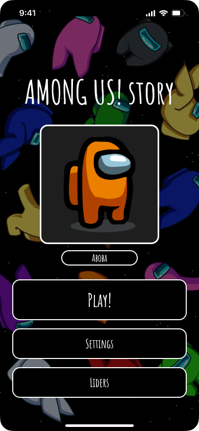
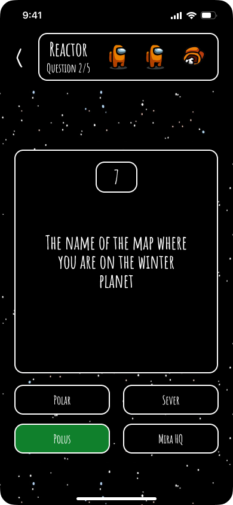
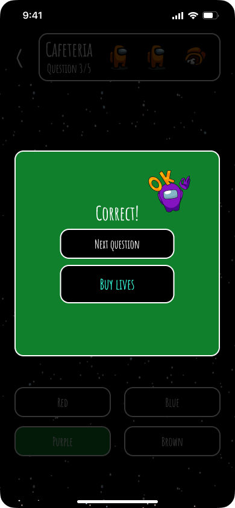
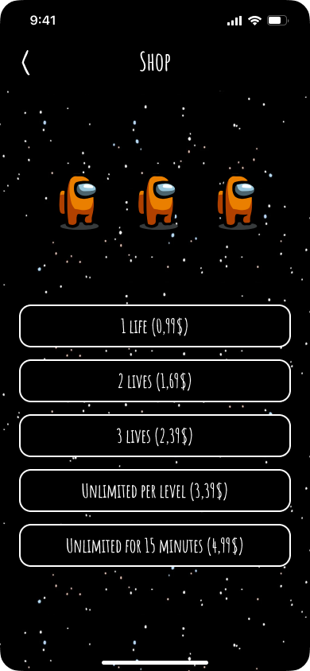

# Among Us Story Mobile Quiz UI

Paid client project: UX/UI for a mobile fan quiz game inspired by *Among Us*, focused on level progression, quick feedback, lives, monetization, and playful mobile interaction.

## Scope

Figma design delivered to a client: the full screen flow, exported here as images.

## Overview

This project explores a mobile quiz experience where the player answers questions about characters, locations, and the internal logic of the *Among Us* universe. The interface was designed to feel atmospheric, intuitive, and strongly connected to the visual language of the original game while remaining easy to use on mobile.

The full concept was created manually in Figma and includes a large set of gameplay and support screens.

## Project Goal

Create a mobile quiz interface that:

- gets the player into gameplay quickly
- supports short, repeatable sessions
- uses game-like feedback to keep engagement high
- adds progression, lives, and monetization without overwhelming the player
- reflects the recognizable visual mood of *Among Us*

## Target Audience

- Age: 10-25
- Players who enjoy *Among Us* and want a quiz-based spin-off experience
- Users who prefer fast gameplay loops and clear mechanics
- Players who respond well to gamification, lives, and progression systems

## UX Solutions

- Minimal steps to start: Play -> choose level -> answer the first question
- Fast screen transitions and immediate correct / incorrect feedback
- A lives system that encourages retries
- Supportive visual cues through icons, colors, and timers
- Flexible setup with character, language, and difficulty selection

## Screen Structure

### Main Screen and Character Selection

- Launch screen with logo and atmospheric background
- Avatar customization by color
- "Play" leads directly into the level flow

### Level Selection

- Easy / Medium / Hard buttons
- UI styled like an in-game control terminal
- Ship map used as a visual metaphor for progress

### Question Screens

- Categories such as Space, Logic, Death, History, and more
- More than 30 question screens in the full concept
- Each question screen includes:
  - timer
  - question number
  - category
  - 3-4 answer buttons
  - lives system
- Every answer transitions into a result screen

### Result Screens

- Correct screen with progress feedback
- Wrong screen with a stronger warning state
- Victory screen
- Defeat screen with replay motivation

### Shop and Monetization

- Buy lives screen
- Options for 1 / 2 / 3 / unlimited per level / unlimited for 15 minutes
- App Store integration represented in the concept

### Settings

- Language selection
- Sound toggle
- Music toggle
- Leaderboard

## Visual Style

- Black outer-space background with scattered stars
- Accent colors: red, green, yellow
- Readable bold headings and high-contrast body text
- Rounded large buttons for mobile interaction
- Character and icon styling aligned with the *Among Us* visual tone

## Key Features

- Built entirely by hand in Figma
- More than 30 screens
- Strong attention to UX details such as timer visibility, menu return flow, and readable structure
- Includes supporting systems beyond the core quiz:
  - shop
  - leaderboard
  - settings

## Outcome

- The client accepted the design on the first presentation
- It demonstrated strong UX logic, color discipline, and interaction design for a game-like product
- It is one of the main case studies in my UX/UI portfolio

## Screens

### Main Screen

### Question Screen

### Correct Answer Screen

### Shop Screen

## Figma

[View the Figma project](https://www.figma.com/design/D1CJAOrQi9klPCMfCifHQe/AMONG-US--story?node-id=0-1&t=YbF4aymvstMLWvKS-1)
